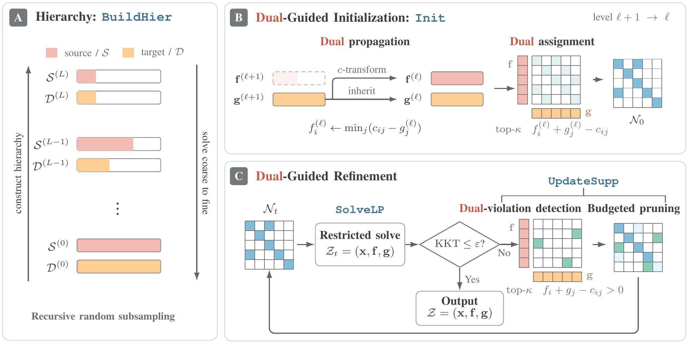
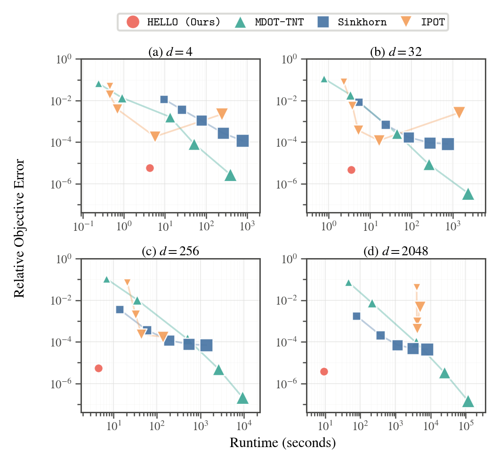

# HELLO

HELLO is a high-performance solver for large-scale, unregularized discrete optimal transport (OT) between point clouds. By combining a dual-guided hierarchy with efficient GPU parallelization, it computes exact sparse transport plans with low memory, fast runtime, and high accuracy. On a single A100 or H100 GPU, HELLO solves instances with millions of points across thousands of feature dimensions.

### Why Choose HELLO?
- **High-Accuracy Sparse Solutions**: Solves unregularized discrete OT to a prescribed full-space relative KKT tolerance (alongside corresponding dual potentials);
- **Million-Scale on a Single GPU**: Memory complexity scales as $\mathcal{O}(m+n)$—"store points, solve transport." A single GPU solves $m=n=1.28\times10^6, d=8192$ using only $41.6\text{ GiB}$ peak GPU memory;
- **Efficiency Across Dimensions**: Maintains high convergence efficiency across feature dimensions from single digits to thousands;
- **General Pairwise Costs**: Supports not only $\ell_2^2$ (squared Euclidean), but also $\ell_1$, $\ell_2$, $\ell_\infty$, and general pairwise cost functions;
- **Backend Design**: Provides a portable PyTorch backend, an optional native CUDA backend, and an optional C++ CPU backend for balanced OT;
- **Beyond Standard OT**: Out-of-the-box support for semi-discrete OT, Gromov–Wasserstein (GW), and unbalanced OT (UOT).

<table style="width: 100%;">
  <tr>
    <td width="60%" align="center">
      
    </td>
    <td width="40%" align="center">
      
    </td>
  </tr>
</table>

## Quickstart

`examples/quickstart.py` can be executed directly on a synthetic Brenier mapping problem ($n=m=2048, d=32$):

```python
import numpy as np
import hello_ot

# 1. Construct test problem with known analytical ground truth
rng = np.random.default_rng(42)
source = rng.normal(size=(2048, 32)).astype(np.float32)
target = source + 2.0 * np.tanh(source)
target = target[rng.permutation(len(target))]

# 2. Solve OT problem (defaults to uniform marginals and squared Euclidean distance)
result = hello_ot.solve(
    source,
    target,
    options=hello_ot.SolverOptions(backend="torch", torch_device="auto"),
)

# 3. Inspect results
print(f"Optimal objective: {result.objective:.6f}")
print(f"Nonzero transport entries: {result.solution.values.size}")

# Sparse transport matrix (scipy.sparse.coo_matrix) and dual potentials (f, g)
x = result.solution.to_sparse_matrix()
f, g = result.solution.source_dual, result.solution.target_dual
```

Array inputs use uniform marginals and squared Euclidean cost by default. Non-uniform masses can be specified via `source_mass` and `target_mass`, and alternative ground costs selected via `cost="l1"`, `"l2"`, or `"linf"`.

Advanced options are configured through `hello_ot.SolverOptions` (e.g., `backend="native"`, `backend="torch"`).

### Optional GPU-resident pipeline

`hello_ot.solve` accepts NumPy arrays and PyTorch tensors. By default, CUDA
inputs are copied to CPU and use the existing streamed solver and NumPy results.
Existing experiment settings and their memory strategy are unchanged.

For contiguous FP32 tensors already on the same CUDA device, explicitly enable:

```python
result = hello_ot.solve(
    source_cuda, target_cuda,
    options=hello_ot.SolverOptions(
        gpu_resident=True,
        consume_input_features=True,
    ),
)
plan = result.solution.to_sparse_matrix()
f, g = result.solution.source_dual, result.solution.target_dual
cpu_solution = result.solution.to_cpu()
```

This requires rebuilding the native extensions from this source revision; older
prebuilt wheels do not include CuPDLPx GPU array I/O. This option currently covers
balanced `hello_ot.solve`. Both clouds, active support, LP state and result arrays
stay on GPU. Leaf POT `emd` and triggered support sparsification are explicit CPU
exceptions, recorded in `result.metadata["transfers"]` by calls, bytes and seconds.
Python control flow and scalar diagnostics still run on CPU.

With `consume_input_features=True`, HELLO temporarily reorders the inputs in place
using bounded scratch and restores their values/order on return or an ordinary
exception. The caller must give HELLO exclusive access during the call and build
any feature-gradient graph **after** it returns: restoration does not reset
PyTorch's tensor version counters. Solver outputs are detached. With this option
false, HELLO creates reordered GPU copies instead. GPU OOM raises an error without
a CPU fallback; a fatal CUDA error may prevent restoration.

Run `python3 scripts/validate_gpu_release.py` from a native CUDA checkout to
validate the GPU-resident path together with the other GPU release checks.

> **Tip**: A complete verification script is bundled in the repository:
> ```bash
> python3 examples/quickstart.py
> ```
> The script solves the problem end-to-end and verifies primal feasibility, dual feasibility, and objective error against the analytical Brenier ground truth.

## Installation Guide

### 1. PyTorch: Out of the Box (`backend="torch"`)

If PyTorch is already installed, install HELLO-OT directly:

```bash
python3 -m pip install .
```

If PyTorch is not installed, or if you plan to test the native backend or run
the paper reproduction, create the recommended `hello_ot` environment:

```bash
bash scripts/create_hello_ot_env.sh hello_ot
```

The script installs Python 3.12, PyTorch 2.7.1 with the CUDA 11.8 runtime,
NumPy 1.26.4, SciPy 1.15.3, and the portable HELLO-OT package. It prefers
Conda and falls back to Micromamba. Replace the final argument with another
name, such as `hello_ot_test`, to create a separate environment.

---

### 2. CUDA: Extreme Performance (`backend="native"`)

Includes resident-streamed CUDA scan kernels and a CUDA-native LP solver:
- **Supported Architectures**: NVIDIA GPUs with compute capabilities `sm_80`, `sm_86`, `sm_89`, `sm_90` (A100, RTX 3080 Ti/3090, RTX 4060 Ti/4090, H100, etc.);
- **Target Environment**: Linux x86-64 (glibc ≥ 2.29), Python 3.12, PyTorch 2.7.1+cu118.

#### Option A: Install Prebuilt Wheel (Recommended, No Local Compilation)

After creating the environment above, install and verify the native wheel:

```bash
bash scripts/install_native.sh hello_ot
```

The script installs the core `hello-ot` and the separate `hello-ot-native`
extension in the existing environment. It does not install the C++ CPU extension.

#### Option B: Build from Source

For development, use Python 3.12, PyTorch 2.7.1+cu118, CUDA 11.8 NVCC and
CCCL headers, a compatible C++ compiler, Ninja, and pybind11:

```bash
conda install -c nvidia cuda-nvcc=11.8 cuda-cccl=11.8.89
python3 -m pip install '.[native-build]'
scripts/build_native_wheel.sh dist
python3 -m pip install dist/hello_ot_native-*.whl
```

Source builds retain the documented Python/PyTorch/CUDA/ABI requirements;
they are not a way to bypass an incompatible environment. The installer
reports expected and actual versions before changing packages.

### 3. C++ CPU (`backend="cpp"`)

`HELLO (C++)` is the official CPU implementation for researchers comparing HELLO
with CPU methods. It shares the hierarchy and refinement algorithm and retains
Python control, PyTorch/BLAS, and POT for the coarsest solve. It is not a standalone
C++ library. This backend supports balanced point-cloud OT with `l2^2`, `l1`,
`l2`, and `linf` costs, all three cost precision policies, and cost perturbation.
GW, UOT, SDOT, GPU-resident execution, and `finest_linf` stopping are not supported
by this backend.

The first prebuilt extensions target Linux x86-64 (glibc >= 2.29) and Python 3.12,
with the system C++ and GNU OpenMP runtimes (`libstdc++` and `libgomp`) available.
Use an existing
Conda/Micromamba environment containing PyTorch (CPU or CUDA) and the numerical
dependencies. The CPU extension does not link LibTorch and does not require CUDA.

```bash
bash scripts/install_cpp.sh hello_ot
```

The script downloads `hello-ot-cpp`, installs the matching core, checks the
extensions, and runs the C++ quickstart. Neither installer creates an environment
or replaces the existing CPU/CUDA PyTorch flavor. The `hello-ot-native` and
`hello-ot-cpp` packages own disjoint files and survive core reinstalls. Either
installer accepts `--wheel /absolute/path/to/the.whl` for a locally built artifact.

For a source build, activate the Python 3.12 Linux x86-64 environment and provide
`g++` with C++17/OpenMP support:

```bash
python3 -m pip install '.[cpp-build]'
bash scripts/build_cpp_wheel.sh dist/cpp
python3 -m pip install dist/cpp/hello_ot_cpp-*.whl
python3 -m hello_ot.diagnose --require-cpp
python3 examples/quickstart.py --backend cpp --num-threads 16
```

Compilation occurs while building wheels, never during `solve` or `prewarm`.
Missing extensions produce installation instructions instead of a silent backend
fallback. Migrate an old combined v0.1.0 native installation once with the new
CUDA installer before adding C++; this preserves CUDA support during the split.
Existing v0.1.0 release artifacts remain unchanged.

```python
options = hello_ot.SolverOptions(backend="cpp", num_threads=16)
result = hello_ot.solve(source, target, options=options)
```

The default is 16 threads; use another positive integer, or `None` to inherit
the environment. Explicit limits temporarily cover Torch/BLAS/OpenMP and are
restored on exit. These settings are process-wide: use separate processes for
concurrent solves requiring independent thread budgets. Existing PyTorch/native
thread policies are unchanged.

### 4. GPU JAX and Paper Reproduction

Public reproduction scripts for the core paper experiments (large-scale scaling, Pareto curves, exactness verification, and parameter sensitivity) are organized under [`export_experiments/`](export_experiments/).

Add GPU JAX, OTT-JAX, and the remaining reproduction dependencies to the same
environment:

```bash
bash scripts/install_jax_gpu.sh hello_ot
conda activate hello_ot
```

The installer keeps PyTorch on cuDNN 9 and places the CUDA 11 JAX requirement
on cuDNN 8 in an isolated sidecar. The environment activation hook selects the
correct CUDA 11.8 tools and libraries automatically. Micromamba environments
use `micromamba activate hello_ot` instead.

For detailed execution instructions, please refer to [export_experiments/README.md](export_experiments/README.md).
